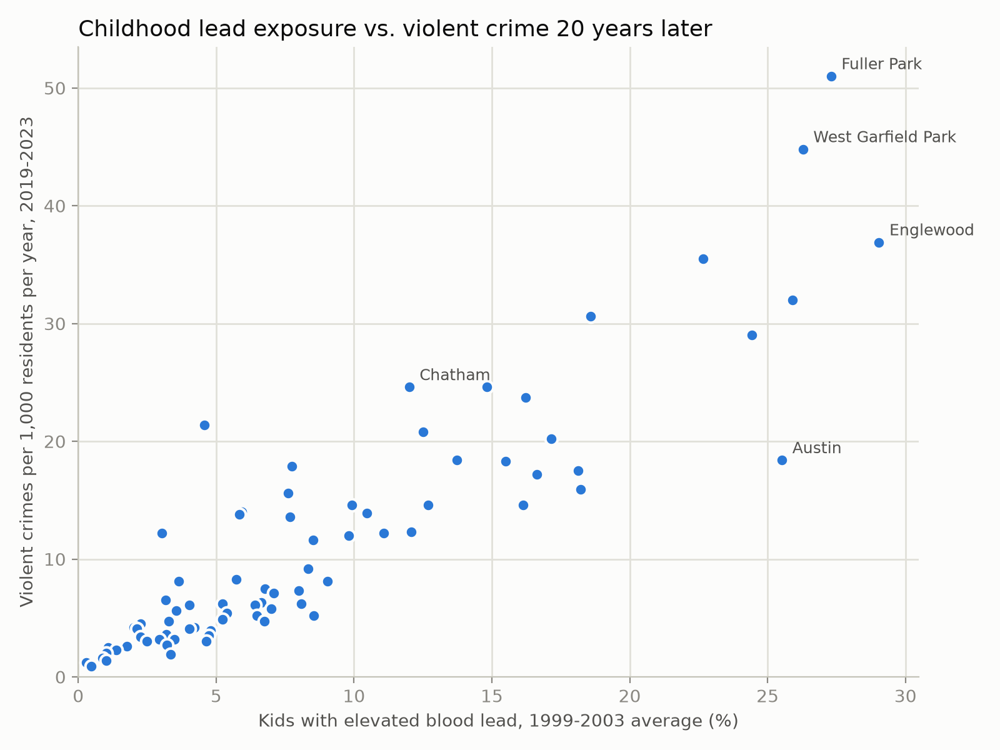

## Childhood Lead Exposure and Violent Crime in Chicago

Do Chicago neighborhoods with higher childhood lead exposure have higher violent crime rates?

## Key findings

- **Strong association.** Childhood lead exposure (1999-2003) is very strongly correlated with violent crime rates 20 years later across Chicago's 77 community areas (r = 0.89).
- **Not explained by the hardship index.** The relationship stays strong among neighborhoods with similar hardship levels (rho = 0.83-0.87).
- **Not specific to the 20-year lag.** Lead and crime from the same years (2003-2007) are just as strongly correlated, so the pattern fits persistently disadvantaged neighborhoods as well as it fits a delayed effect of lead.

Lead exposure is a very strong marker of where violent crime concentrates in Chicago, but neighborhood-level data can't show that lead causes it.



## Questions

1. Do community areas with higher rates of elevated levels of lead in kids have higher violent crime rates years later, when those kids are young adults?
2. Does that relationship hold with neighborhoods of similar hardship levels?
3. How does the multiple year lagged relationship compare to a same year baseline?

## Data

All data from the [Chicago Data Portal](https://data.cityofchicago.org), listed on data.gov. Every dataset joins on Chicago's 77 community areas. 

| Dataset | ID | Years | Used for |
|---|---|---|---|
| Blood lead screening, kids 0-6 | `v2z5-jyrq` | 1999-2013 | Childhood lead exposure |
| Crimes, 2001 to present | `ijzp-q8t2` | 2001-2025 | Violent crime counts |
| Socioeconomic indicators | `kn9c-c2s2` | 2008-2012 | Hardship index (poverty control) |
| ACS 5-year data by community area | `t68z-cikk` | 2019-2023 | Population, for crime rates |
| Community area boundaries | `igwz-8jzy` | n/a | Matching neighborhood names to numbers |

Crime data before 2003 is excluded because community area was missing for about 99% of 2001 crimes and 27% of 2002 crimes.

Violent crime uses the FBI's index crime codes: murder, criminal sexual assault, robbery, aggravated assault, and aggravated battery.

### Cleaned data

| File | Rows | One row per |
|---|---|---|
| `blood_lead.csv` | 1,155 | neighborhood per year (1999-2013) |
| `crimes_by_area_year.csv` | 1,771 | neighborhood per year (2003-2025) |
| `socioeconomic.csv` | 77 | neighborhood |
| `population.csv` | 77 | neighborhood |

All four use `community_area_number` as the shared key.

## Method

1. **Extract:** pulled five datasets from the Chicago Data Portal API. Crime was counted by year, neighborhood, and crime type on the server, so the download was about 64,000 rows instead of 8 million records.
2. **Transform:** cleaned each dataset in pandas, reshaped the lead data from wide to long, converted fake zeros to missing values, and checked every output's row count.
3. **Load:** loaded the cleaned files into a DuckDB database.
4. **Analyze:** used SQL to calculate each neighborhood's average lead exposure and violent crime rate per 1,000 residents per year, then measured the relationship with Pearson and Spearman correlations in Python.

Every cleaning and analysis decision is documented in [`NOTES.md`](NOTES.md).

## Findings

### 1. Lead exposure and violent crime are strongly correlated

| Comparison | Correlation |
|---|---|
| Lead (1999-2003) vs. violent crime (2019-2023) | r = 0.89 |
| Hardship index vs. violent crime | r = 0.63 |
| Lead vs. hardship index | r = 0.62 |

The relationship is very strong (p < 0.001), and stronger than the relationship between hardship and crime. Spearman's rank correlation gives the same result (rho = 0.89), so it isn't driven by a few extreme neighborhoods.

Violent crime rates range from 0.9 per 1,000 residents per year (Edison Park) to 51.0 (Fuller Park). Four of the five neighborhoods with the highest violent crime rates are also in the top five for childhood lead exposure.

The clearest exception is Riverdale: low lead exposure (4.6%) but high violent crime (21.4) and the highest hardship score in the city.

### 2. The relationship holds within similar hardship levels

| Hardship group | Neighborhoods | Spearman rho |
|---|---|---|
| Low | 26 | 0.87 |
| Medium | 25 | 0.87 |
| High | 26 | 0.83 |

All p < 0.001. If poverty, as measured by the hardship index, explained the relationship, it should weaken a lot among neighborhoods with similar hardship. It barely changes.

### 3. The 20-year lag is no stronger than the same-year relationship

| Comparison | Pearson r | Spearman rho | Neighborhoods |
|---|---|---|---|
| Lagged: lead 1999-2003, crime 2019-2023 | 0.89 | 0.89 | 77 |
| Same-year: lead 2003-2007, crime 2003-2007 | 0.91 | 0.85 | 76 |

The lead hypothesis predicts a delayed effect, so the lagged relationship should be stronger. It isn't. Neighborhoods with high lead exposure also had high violent crime at the same time and 20 years later. Comparing neighborhoods can't separate a delayed effect of childhood lead exposure from places that stayed disadvantaged across decades.

## Tools

- **Python:** pandas, requests, SciPy, matplotlib
- **SQL:** DuckDB
- **Other:** Jupyter, Git, VS Code

## Project structure

```
lead-crime-chicago/
├── data/
│   ├── raw/            # API pulls, untouched (not tracked in git)
│   └── processed/      # cleaned data (not tracked in git)
├── figures/
│   └── lead_vs_crime.png
├── notebooks/
│   ├── 01_explore.ipynb        # data quality checks on all five datasets
│   ├── 02_lead_reshape.ipynb   # prototype of the lead reshape
│   └── 03_analysis.ipynb       # SQL queries, chart, and correlations
├── sql/
│   ├── 01_neighborhood_summary.sql   # lead exposure, crime rate, and hardship per neighborhood
│   └── 02_same_year_baseline.sql     # same-year comparison (2003-2007)
├── src/
│   ├── extract.py      # pulls all five datasets from the API
│   ├── transform.py    # cleans and standardizes the raw data
│   └── load.py         # loads cleaned data into DuckDB
├── NOTES.md            # decisions made along the way, and why
├── README.md
└── requirements.txt
```

## Setup

```bash
python3 -m venv .venv
source .venv/bin/activate
pip install -r requirements.txt
python src/extract.py
python src/transform.py
python src/load.py
```


Then open `notebooks/03_analysis.ipynb` and run all cells to reproduce the results.


## Limitations

- **Area-level data.** This shows that neighborhoods with more lead exposure have more violent crime. It can't say anything about individuals.
- **Neighborhood stability.** The same neighborhoods stayed high on lead, crime, and disadvantage for decades, so this data can't separate a delayed effect of lead from persistent disadvantage.
- **What the hardship index doesn't measure.** It covers income, poverty, unemployment, education, crowding, and age. It doesn't capture housing age and condition, historical segregation, or long-term disinvestment, which are closely tied to where lead exposure was highest.
- **Small sample.** 77 community areas, and some have very small populations. Fuller Park has the highest crime rate but only about 2,200 residents, so a few incidents move its rate a lot.
- **People move.** Kids tested in a neighborhood in 2000 don't all live there in 2020.
- **Changing definition of "elevated."** This data uses 10 µg/dL. The CDC reference value is now 3.5 µg/dL.
- **Reported crime.** Police data reflects crimes that were reported and recorded, which depends partly on where police patrol.
- **Timing of the hardship index.** It covers 2008-2012, between the lead and crime periods.
- **Crime data starts in 2003.** Community area wasn't recorded reliably before then.
- **Population timing in the baseline.** The 2003-2007 comparison uses 2019-2023 population, the only population data available by community area.
- **Riverdale has no lead data after 2002.** Its 1999-2003 average uses four years, and it's left out of the same-year baseline.